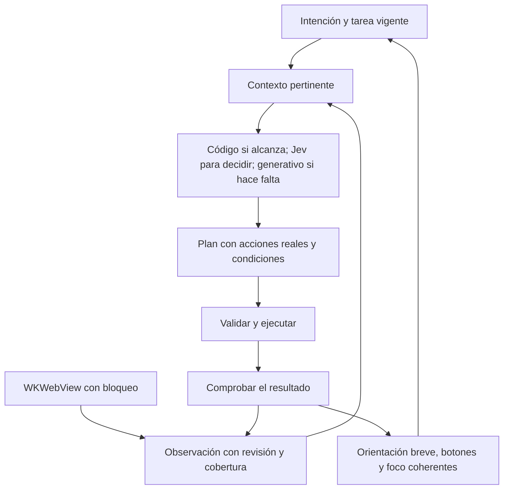

# Auditoría del mecanismo de JEF — 24 de septiembre de 2026

La dirección de la rama es buena: página original, intención persistente, mapa compartido, decisiones acotadas con Jev y lenguaje con el modelo generativo. Todavía falta un contrato fiable entre observar, decidir, actuar, comprobar y presentar. Ese es el siguiente salto de calidad. Cambiar de modelo antes de resolverlo puede producir respuestas mejores sobre una página equivocada.

Alcance: revisión de `f1-arquitectura` hasta `916bda9`, incluyendo el bloqueo de anuncios que se terminó de integrar durante esta auditoría. Se leyeron código, cambios recientes, documentación de intención y corridas existentes del 24/9. La documentación se contrastó contra el código; no se tomó como prueba de que todo lo descrito funciona. Se investigaron fuentes oficiales de proyectos abiertos. Esta auditoría no modifica la aplicación.

Se obtuvo una captura directa del simulador encendido. El control interactivo de Computer Use informó permisos de macOS pendientes; no se completó un recorrido nuevo por esa vía. Los ejemplos de navegación siguientes proceden de las corridas guardadas en la rama, no de una nueva prueba manual. Las estimaciones de voz de esas corridas tampoco equivalen a escuchar VoiceOver en un iPhone.

## La experiencia que debería gobernar la arquitectura

JEF debería conservar **qué vino a hacer la persona, dónde está, qué información falta y cuál es el siguiente paso disponible**. El tipo de sitio ayuda a interpretar; los controles y el contenido actuales determinan lo que realmente se puede ofrecer.

Ejemplo en La Nación, como comportamiento propuesto:

1. En la portada, sin una tarea definida: orientación breve y opciones reales para titulares, secciones, buscar o ingresar.
2. Al elegir Deportes: conservar esa elección, presentar noticias de esa sección en su orden y permitir continuar. Evitar volver a preguntar genéricamente qué quiere hacer con el sitio.
3. Al elegir una noticia: abrirla, comprobar si llegó al artículo o a una barrera y ofrecer leer o resumir el contenido efectivamente disponible.
4. Al pedir ingresar: presentar los métodos que existen en esa pantalla —Google, Apple, correo, si están— como opciones de una misma tarea. Conservar el destino de retorno al finalizar.

La clasificación «news» no debería obligar a leer titulares cuando la persona quiere ingresar. «government» tampoco demuestra que un sitio sea oficial. La intención prioriza, la página aporta evidencia y las capacidades reales limitan las acciones.

## Lo que conservaría

- La sesión y la página original en WKWebView: mantienen formularios, cookies y una vía de interacción directa.
- El mapa compartido de `options(of:)`, los identificadores de acciones y la vinculación de sugerencias a elementos reales.
- La tarea persistente y las preguntas con opciones: mejoran la continuidad frente al asistente que reinicia en cada página.
- Jev para sitio, página y aviso en una sola consulta, con incertidumbre y respaldo generativo.
- Los nombres literales de destinos, los valores provenientes de la persona, los límites de pasos y la opción de volver.
- Las listas comunitarias aplicadas por WebKit antes de cargar recursos, y Mozilla Readability para artículos.

Estos avances resuelven parte de los diagnósticos anteriores. Los hallazgos de abajo son los que siguen presentes en el corte revisado.

## Hallazgos prioritarios

### 1. P1 — Una respuesta atrasada puede describir otra página

**Evidencia registrada:** en Gob.pe, después de buscar «pasaporte», el registro muestra portada a +37,8 s, resultados a +40,2 s y una orientación de la portada a +41,0 s. Los botones también corresponden a la portada. La página nueva ya había llegado antes de terminar la respuesta vieja. Véase la [corrida de Gob.pe](</Users/daniel/Developer/JEF- BROWSER/Tests/corridas/2026-09-24_con-listas/buscar-en-gobpe/transcripcion.md:60>).

**Mecanismo:** `arrived(page)` conserva su argumento durante las consultas a Jev y al generativo y después publica sin comprobar una revisión vigente. `pageChanged` ignora cambios mientras hay trabajo en curso; además trata cambios de consulta y fragmento como el mismo lugar. El motor sí tiene protecciones contra algunas cargas reemplazadas, pero no abarcan todo el ciclo de inferencia y presentación. [Assistant.swift](</Users/daniel/Developer/JEF- BROWSER/Sources/Intelligence/Assistant.swift:2586>).

**Cambio propuesto:** cada observación debe tener sesión, documento y revisión. Cada decisión, resultado y conjunto de botones debe referirse a esa revisión. Antes de publicar o actuar, comprobar vigencia; si cambió lo relevante, actualizar. Conservar el último cambio pendiente en lugar de descartarlo mientras el asistente trabaja. Cancelar trabajo obsoleto cuando se pueda, pero también validar al recibirlo: cancelar solo no alcanza.

Esto evita gastar llamadas y tiempo de escucha en una pantalla que ya no existe. No requiere llamar a otro modelo.

### 2. P1 — Se confunde «ejecuté una instrucción» con «funcionó»

`HeadlessWebView.write` descarta el resultado de `fill`, espera 700 ms y termina. Su llamador puede decir «Listo, escrito» y enviar sin saber si el campo existía o conservó el valor. [HeadlessWebView.swift](</Users/daniel/Developer/JEF- BROWSER/Sources/Engine/HeadlessWebView.swift:246>), [Assistant.swift](</Users/daniel/Developer/JEF- BROWSER/Sources/Intelligence/Assistant.swift:2065>).

Después de un movimiento, una decisión insegura de Jev termina el bucle y pasa a describir el destino. Eso limita vueltas, pero no distingue tarea cumplida, bloqueo, carga pendiente y falta de evidencia. [Assistant.swift](</Users/daniel/Developer/JEF- BROWSER/Sources/Intelligence/Assistant.swift:1928>).

**Cambio propuesto:** ejecutar acciones con resultados explícitos: valor aceptado, navegación iniciada, resultado disponible, validación rechazada, objetivo cumplido o estado desconocido. Comprobar primero con datos del navegador: valor, selección, error asociado, URL, diálogo o región modificada. Reservar Jev para interpretar cambios ambiguos. Decir que algo terminó solo cuando exista evidencia suficiente; cuando no, explicar el estado y ofrecer el siguiente paso.

Las esperas deben tener una condición y un plazo máximo. Una pausa fija puede ser demasiado larga para una página rápida y demasiado corta para otra lenta.

### 3. P1 — El mapa común todavía pierde contenido

`collectListings` limita listas seleccionadas a 30 elementos y el recorrido omite descender por el contenedor que representó como lista. Eso puede omitir del recorrido el contenido de los elementos posteriores; algunas acciones pueden sobrevivir por otra vía, pero no su representación completa. Luego `options(of:)` recorta el mapa a 240 opciones. Compartir ese mapa mejora la coherencia, pero todos pueden compartir la misma omisión. [extract.js](</Users/daniel/Developer/JEF- BROWSER/Sources/Extraction/extract.js:1545>), [recorrido de listas](</Users/daniel/Developer/JEF- BROWSER/Sources/Extraction/extract.js:2855>), [options](</Users/daniel/Developer/JEF- BROWSER/Sources/Intelligence/Assistant.swift:3074>).

Además, la firma de cambios omite el contenido del texto. Swift también considera equivalentes páginas con la misma forma, cantidades y acciones. Un resultado, precio o mensaje puede cambiar sin alterar esa forma. Evitar anuncios por cada ticker es razonable; descartar la actualización de datos tiene otro efecto. [PageModel.swift](</Users/daniel/Developer/JEF- BROWSER/Sources/Engine/PageModel.swift:38>), [signatureOf](</Users/daniel/Developer/JEF- BROWSER/Sources/Extraction/extract.js:3644>).

**Cambio propuesto:** conservar localmente un inventario ampliable y separar tres decisiones: qué se observó, qué necesita ver el modelo y qué conviene anunciar. Enviar encabezados, grupos y los elementos pertinentes; recuperar más por sección, consulta o continuación. Registrar cobertura: completo para esa región, recortado o pendiente de cargar. «No apareció en esta muestra» debe permitir ampliar, no convertirse en «no está».

El extractor actualmente baja al final hasta cuatro veces para despertar contenido. Conviene una primera lectura útil y expansión dirigida al pedido, manteniendo el lugar de la persona. Es una oportunidad de reducir espera, desplazamientos y carga de feeds innecesarios. Requiere medir cobertura antes de reemplazarlo. [wakeLazyContent](</Users/daniel/Developer/JEF- BROWSER/Sources/Extraction/extract.js:3207>).

### 4. P1 — La incertidumbre de Jev puede convertirse en certeza fabricada

`PageAnalyzer.find` descarta candidatos con probabilidad inferior a 0,1. Si no queda ninguno y respondieron todas las tandas, devuelve `confidence: 1`, sin exigir una probabilidad alta de «none». Una distribución dispersa entre muchos elementos puede generar ese resultado. [PageAnalyzer.swift](</Users/daniel/Developer/JEF- BROWSER/Sources/Intelligence/PageAnalyzer.swift:357>).

También pregunta si lo solicitado se puede obtener **leyendo la página**, pero esa consulta recibe los elementos de la tanda, no el texto completo de la página. Es evidencia insuficiente para algunas preguntas. La combinación puede activar una salida al buscador con más seguridad de la justificada.

**Cambio propuesto:** preservar las probabilidades de «none», los errores y la cobertura. Distinguir «ninguna opción de esta tanda», «falta observar» y «la página no permite resolverlo». La presencia de una respuesta textual debe juzgarse sobre los fragmentos relevantes del contenido. Mantener la salida desconocida. El umbral 0,7 necesita calibración por tipo de decisión; por sí solo no significa 70 % de éxito real.

### 5. P1 — La protección ante consecuencias está ligada a formularios

`submitAsked` consulta si una acción compromete a la persona. El bucle general puede activar un botón elegido por Jev o por coincidencia exacta sin pasar por esa misma evaluación. Una web puede implementar «Confirmar», «Eliminar» o «Comprar» como botón JavaScript fuera de un formulario. La confianza en cuál botón corresponde no mide las consecuencias de pulsarlo. [submitAsked](</Users/daniel/Developer/JEF- BROWSER/Sources/Intelligence/Assistant.swift:2101>), [run](</Users/daniel/Developer/JEF- BROWSER/Sources/Intelligence/Assistant.swift:1812>).

**Cambio propuesto:** una única política de ejecución para formularios, botones, enlaces y sugerencias, que tenga en cuenta acción y autorización de la persona. Revisar también existencia, identidad, destino y estado actual del control. Hoy hay comprobación de nombre al activar algunos controles; hay que extender el contrato a todos los caminos.

Las instrucciones de una página son contenido no confiable. El propio sitio no puede ampliar la autorización de la persona. Los prompts actuales incluyen esta distinción en varios lugares; debe sostenerse también en el ejecutor.

### 6. P2 — La continuidad y el comportamiento sin modelo siguen siendo frágiles

La tarea persistente es un avance, pero sigue siendo un texto acompañado por varios estados de continuación. No hay un único registro explícito de objetivo, paso, dato pendiente, bloqueo, progreso y condición de finalización. Eso dificulta conservar «quiero ingresar para seguir leyendo esta noticia» a través de ventanas y redirecciones. [Estado del asistente](</Users/daniel/Developer/JEF- BROWSER/Sources/Intelligence/Assistant.swift:99>).

En Liverpool, una orientación `unusable` lleva a la plantilla, que presenta promociones como «Las primeras notas» y ofrece seguir leyendo o resumir. Aunque Jev se consulta antes, su clasificación no se conserva como base de presentación antes de ese retorno. [Corrida Liverpool](</Users/daniel/Developer/JEF- BROWSER/Tests/corridas/2026-09-24_con-listas/tienda-liverpool/transcripcion.md:13>), [retorno a plantilla](</Users/daniel/Developer/JEF- BROWSER/Sources/Intelligence/Assistant.swift:2708>).

**Cambio propuesto:** estado de tarea explícito y un plan de interacción único que produzca texto, botones y foco desde la misma evidencia. Si falla la redacción, conservar el tipo reconocido y las acciones observadas: por ejemplo buscador, categorías e ingreso reales de la tienda. Si no se sabe el tipo, usar lenguaje neutral. No perder toda la orientación porque falló un campo de la respuesta generativa.

### 7. P2 — Hay llamadas evitables, incluso usando un modelo barato

Para pedidos libres con una página abierta se inicia `find` especulativamente junto al router. Puede resultar útil para abrir algo, pero innecesario para resumir, leer o contestar. Cambiar la referencia `early` a `nil` no cancela explícitamente esa tarea. Además, la búsqueda hace una ronda final aunque solo hubiera una tanda. Para 240 opciones pueden ser siete llamadas de primera ronda y una final, antes de contar el router, la orientación o una reinterpretación. No todos los turnos usan ese máximo y los botones ya resueltos tienen atajos. [Inicio especulativo](</Users/daniel/Developer/JEF- BROWSER/Sources/Intelligence/Assistant.swift:408>), [tandas](</Users/daniel/Developer/JEF- BROWSER/Sources/Intelligence/PageAnalyzer.swift:357>).

**Cambio propuesto:** primero ejecutar comandos inequívocos ya estructurados; después seleccionar contexto por región y tarea; consultar Jev cuando aporta una decisión pendiente; escalar al generativo si hace falta. Evitar una final redundante cuando una sola tanda ya respondió con suficiente evidencia. Cancelar consultas descartadas y medir cuántas se aprovechan. La especulación puede quedar donde el ahorro de latencia justifica el costo.

Guardar clasificaciones y acciones resueltas por revisión relevante y tarea, con invalidación por cambios. No guardar únicamente por URL: un mismo URL puede mostrar otro formulario o resultado. Mantener la orientación inicial breve y generar explicaciones amplias cuando se solicitan.

### 8. P2 — Falta ampliar el contrato de navegador

La extracción se inyecta solo en el marco principal y el recorrido usa el DOM habitual; no hay una estrategia completa para marcos y shadow DOM. Afecta formularios, componentes y métodos de ingreso. Las ventanas nuevas se cargan en la misma vista; eso puede romper flujos que necesitan una ventana auxiliar y comunicación con su origen. Son riesgos arquitectónicos identificados, no una prueba de que todos los logins fallen. [Inyección](</Users/daniel/Developer/JEF- BROWSER/Sources/Engine/HeadlessWebView.swift:404>), [ventanas](</Users/daniel/Developer/JEF- BROWSER/Sources/Engine/HeadlessWebView.swift:579>).

La corrida de IMSS también documenta un enlace de descarga que deja el recorrido sin página; la nota del último commit reconoce este pendiente. Deben existir resultados distintos para navegación, archivo, ventana de autenticación y aplicación externa, preservando la tarea y la vuelta al sitio.

**Cambio propuesto:** extender por capacidades, con identidades de documento/marco, y ofrecer continuar en la página original cuando una interacción no esté cubierta. No fingir que el mapa representa toda la web cuando faltan regiones.

## Dos deudas transversales

La comprobación de cifras valida el array `cifras` declarado por el mismo modelo, no todos los números efectivamente escritos en la respuesta. Un array vacío supera la validación; encontrar un número en la página tampoco acredita que corresponda al producto o fecha narrados. Vincular afirmaciones importantes con bloques fuente e identificar relaciones de dato y entidad. La lectura literal debe seguir siendo una opción. [Answerer.swift](</Users/daniel/Developer/JEF- BROWSER/Sources/Intelligence/Answerer.swift:128>).

Las claves de los proveedores se leen desde el bundle, una deuda ya reconocida por el proyecto. Antes de distribuir, conviene un servicio autenticado con límites de gasto y credenciales fuera del binario. No hace falta mover el navegador ni la sesión de la persona a un servidor para resolverlo. Los valores sensibles de campos deben seguir el camino local; la observabilidad debe medir tiempos y decisiones sin registrar esos valores. [Gemini.swift](</Users/daniel/Developer/JEF- BROWSER/Sources/Intelligence/Gemini.swift:35>).

## Dónde usar mejor Jev

| Trabajo | Primera opción | Cuándo escalar |
|---|---|---|
| Volver, continuar lectura, tocar una opción ya vinculada | Código y estado actual | Si la opción dejó de existir o cambió |
| Rol, etiqueta, campo obligatorio, estado seleccionado | Semántica HTML/ARIA y navegador | Jev para ambigüedad residual |
| Sitio, página y aviso | Jev en una consulta compacta | Tipo desconocido o evidencia contradictoria |
| Elegir el siguiente elemento para la tarea | Jev sobre una región pertinente, con contexto y opción desconocida | Ampliar observación; luego generativo si persiste ambigüedad |
| Distinguir error, bloqueo o avance después de actuar | Comprobación local; Jev si el cambio es semántico | Generativo para interpretar una situación compleja |
| Entender un pedido abierto, explicar o resumir | Modelo generativo con evidencia pertinente | Modelo más capaz solo si el costo y la mejora están medidos |

La idea de clasificar tienda/gobierno es útil y ya está implementada de forma compacta, con categorías alternativas. La siguiente ganancia está en clasificar **el estado de la interacción**: resultados disponibles, formulario pendiente, validación, autenticación necesaria o tarea resuelta. Es más cercano al siguiente paso de la persona que agregar una taxonomía enorme de sitios.

No haría una pregunta remota por cada nodo para decidir si es ruido. La sesión del 24/9 ya registra que ese intento costaba mucho más de lo que ahorraba. Tampoco duplicaría en Jev decisiones que el navegador conoce de manera directa.

## Bloqueo de anuncios: mantenerlo y medir el beneficio correcto

La implementación final usa EasyList/EasyPrivacy, conversión con SafariConverterLib y WKContentRuleList. Es una elección adecuada para esta base iOS. WebKit compila las reglas y las aplica a recursos y filtrado cosmético; no requiere un modelo por anuncio. [WebKit](https://webkit.org/blog/3476/content-blockers-first-look/).

El beneficio tiene tres medidas separadas: recursos/bytes, tiempo hasta contenido útil y texto/tokens enviados. No se pueden intercambiar. Según la medición registrada en la rama, Clarín pasó de 118 a 55 pedidos, pero las cargas con listas de esa prueba fueron de 5,0–7,8 s frente a 4,5 s sin ellas. En diarios el texto apenas cambiaba porque muchos anuncios estaban en marcos que ya no se extraían; en una búsqueda de Google se redujo alrededor de un tercio. Son muestras del proyecto, no un ahorro general garantizado. [Medición y corrección de carga](</Users/daniel/Developer/JEF- BROWSER/docs/auditoria-cadena-2026-09-23.md>).

Dos mejoras concretas: identificar versiones compiladas por hash de contenido, en lugar de tamaño del archivo; y ofrecer una recuperación por sitio cuando el bloqueo impida una tarea. Agregar actualización controlada de listas con última versión utilizable. Medir primera compilación separada de cargas posteriores.

Conviene describirlo como bloqueo comunitario adaptado a WebKit. SafariConverterLib separa reglas nativas y reglas avanzadas; el script actual guarda las avanzadas en el temporal y la app carga el JSON nativo. Por eso no equivale a toda la protección o compatibilidad de Brave. Bloquear solicitudes evita su carga; ocultar con CSS no implica necesariamente evitar la descarga. [SafariConverterLib](https://github.com/AdguardTeam/SafariConverterLib).

## Herramientas abiertas que sí evaluaría

| Proyecto | Aporte concreto | Encaje en JEF |
|---|---|---|
| [SafariConverterLib](https://github.com/AdguardTeam/SafariConverterLib) y listas comunitarias | Conversión de reglas para WebKit; ya incorporada | Conservar y mejorar actualización/recuperación |
| [Brave adblock-rust](https://github.com/brave/adblock-rust) | Motor abierto y conversión al formato de Apple mediante `content-blocking` | Alternativa para comparar conversión/cobertura; no hay evidencia aquí para cambiar el convertidor actual |
| [Mozilla Readability](https://github.com/mozilla/readability) | Extracción de artículos de Firefox Reader View | Conservar para artículos; no usar su salida como representación universal de portadas, tiendas y formularios |
| [dom-accessibility-api](https://github.com/eps1lon/dom-accessibility-api) | Cálculo de nombre y descripción accesibles conforme a AccName | Candidato para contrastar o sustituir partes de `spokenName`/etiquetado; empaquetar y medir compatibilidad/costo en WKWebView. Es una biblioteca orientada a pruebas, no garantía de equivalencia total con VoiceOver |
| [Playwright](https://playwright.dev/docs/actionability) | Comprobaciones de visibilidad, estabilidad, recepción de eventos y disponibilidad antes de actuar; aserciones con espera | Adoptar el contrato de ejecución y usarlo como referencia en pruebas. No es un SDK Swift intercambiable con el WKWebView actual |
| [Stagehand](https://docs.stagehand.dev/v3/basics/observe) | Separar descubrimiento de acciones estructuradas y ejecución; reutilizar lo resuelto | Adoptar ese diseño y una caché local con revisiones. Su caché de servidor es una prestación específica de Browserbase, no una capacidad automática de JEF |
| [axe-core](https://github.com/dequelabs/axe-core) | Detectar problemas automatizables de accesibilidad web | Ayuda en diagnóstico y regresiones; no decide la intención ni acredita la experiencia nativa de VoiceOver |

También revisé [Browser Use](https://github.com/browser-use/browser-use). Es relevante como referencia de agentes que usan un navegador local o remoto, pero adoptarlo como núcleo implicaría otra integración, ciclo de agente y posiblemente infraestructura. No lo priorizaría sobre corregir el mecanismo actual. La página original, la sesión local y el control accesible de la persona son parte del producto.

Playwright MCP muestra que es posible operar con representaciones estructuradas de accesibilidad sin mandar capturas al modelo continuamente. Es una referencia de diseño, no una razón para agregar MCP dentro de JEF. [Proyecto oficial](https://github.com/microsoft/playwright-mcp).

## Arquitectura propuesta y costo

Esto puede introducirse gradualmente en los componentes actuales. Empezaría por el contrato entre `ReaderModel` y `Assistant`; no por una reescritura total ni por agregar más agentes.

La unidad económica debe ser **costo por tarea completada**, acompañada de éxito y esfuerzo de la persona. Un filtro barato deja de ahorrar si se consulta varias veces y después se llama igualmente al generativo. En una cascada sencilla, el costo esperado es `costo_Jev + probabilidad_de_escalar × costo_generativo`, más reintentos y contexto extra. La comparación debe incluir todo eso.

Medir con las corridas existentes: tiempo hasta primera orientación útil, tiempo hasta completar, pasos y correcciones de la persona, llamadas aprovechadas/descartadas, tokens por función, frecuencia de respuestas obsoletas y tareas finalizadas con evidencia. Para voz, medir también duración de orientación e interrupciones reales. La cola y el foco necesitan validación en iPhone y con personas usuarias; una captura o un árbol de accesibilidad no bastan.

## Orden recomendado

1. **Corregir sincronización y resultados de acciones.** Caso de aceptación: Gob.pe debe terminar con sus resultados y ninguna respuesta posterior de la portada; un campo que no se llenó no puede anunciarse como completado. Resolver también la certeza artificial de `find` y la política común de ejecución.
2. **Preservar información y declarar cobertura.** Una lista larga debe poder recorrerse completa y ampliar contexto sin mandar todos los elementos a todos los modelos. Actualizar datos sin anunciar cada cambio incidental.
3. **Unir tarea, presentación y recuperación.** Comprobar portada → categoría → noticia y noticia → ingreso → retorno; una caída del modelo debe dejar acciones útiles y neutrales.
4. **Reducir llamadas y espera.** Reutilizar clasificación/acciones vigentes, evitar tandas/finales redundantes y medir cuándo conviene especular. Mantener el bloqueo nativo y medir red, extracción e inferencia por separado.
5. **Ampliar capacidades del navegador.** Priorizar archivos, ventanas de autenticación, marcos y componentes según fallos observados en tareas reales. Después comparar modelos por tarea completa.

Mi recomendación es mantener la base elegida y concentrar el próximo trabajo en evidencia, continuidad y ejecución. Son mejoras que ayudan simultáneamente a la persona, a la confiabilidad del sistema y al costo.
